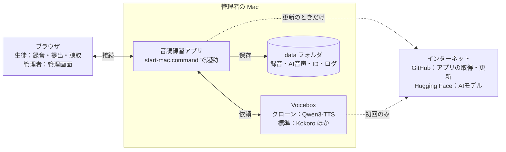

# Mac 導入・操作マニュアル

このページの手順どおりに進めると、何も入っていない Mac から音読練習アプリを起動し、管理画面で使えるようになります。初回の準備は1時間ほどです。2回目からは「Voicebox を開く → 起動ファイルをダブルクリック」の2ステップです。

**目次**：[全体の仕組み](#全体の仕組み) ・ [作業チェックリスト](#作業チェックリスト) ・ [1. 用意するもの](#1-用意するもの) ・ [2. Voicebox とは](#2-voicebox-とはvoicevox-との違い) ・ [3. ターミナルの使い方](#3-ターミナルの使い方) ・ [4. 初回の準備](#4-初回の準備一度だけ) ・ [5. 起動と終了](#5-起動と終了) ・ [6. 更新](#6-更新のしかた) ・ [7. 管理画面](#7-管理画面の機能) ・ [8. 生徒の画面](#8-生徒の画面) ・ [9. 使い方の流れ](#9-使い方の流れ) ・ [10. 困ったとき](#10-困ったとき) ・ [11. データの扱い](#11-データの扱い)

## 全体の仕組み

生徒の声は Mac の外に出ません。AI音声は、Mac の中で動く Voicebox が作ります。



管理者が操作するのは、ブラウザの管理画面だけです。Voicebox は起動しておくだけで、操作する必要はありません。インターネットにつなぐのは、初回の準備と更新のときだけです。

## 作業チェックリスト

終わったものから順に進めてください。括弧内はこのページの章です。

**初回だけ（約1時間）**

- [ ] Mac のチップと空き容量を確認した（1）
- [ ] ターミナルを開けた（3）
- [ ] `git --version` でバージョンが表示された（4-1）
- [ ] `python3.13 --version` で 3.13.x と表示された（4-2）
- [ ] Voicebox を入れて開けた（4-3）
- [ ] ホームフォルダに `create-voice` フォルダができた（4-4）
- [ ] `start-mac.command` で起動し、管理画面にログインできた（5）
- [ ] 仮の生徒で「録音 → 提出 → 聴取」を試した（9）

**毎回**

1. Voicebox を開く
2. ホームフォルダの `create-voice` → `start-mac.command` をダブルクリック
3. 使い終わったら、ターミナルの画面で `control + C`

## 1. 用意するもの

Apple シリコン（M1〜M4 など）の Mac を推奨します。Intel の Mac でも動きますが、AI音声の生成にかなり時間がかかります。

| 項目 | 目安 | 確認のしかた |
| --- | --- | --- |
| チップ | Apple シリコン推奨 | 画面左上の Apple メニュー →「この Mac について」→「チップ」が「Apple M…」なら Apple シリコン |
| macOS | 13 Ventura 以降 | 同じ画面の「macOS」の欄 |
| メモリ | 16GB 以上推奨（8GB でも動作はします） | 同じ画面の「メモリ」の欄 |
| 空き容量 | 20GB 以上（AIモデルで約5〜10GB） | Apple メニュー →「システム設定」→「一般」→「ストレージ」 |
| インターネット | 初回のダウンロード時と更新時に必要 | — |
| ブラウザ | Chrome または Safari | — |

## 2. Voicebox とは（VOICEVOX との違い）

Voicebox は、AI音声を Mac の中だけで作る無料・オープンソースのアプリです（MIT ライセンス）。音読練習アプリは Voicebox に依頼して、生徒の声に似せた「AI音声（クローン）」と、全員共通の「AI音声（標準）」を作ります。生徒の声はインターネットに送られません。

名前が似ていますが、VOICEVOX（ずんだもんなどの読み上げソフト）とは別のソフトです。

| | Voicebox（このアプリで使用） | VOICEVOX |
| --- | --- | --- |
| できること | 録音した声をまねる（クローン）、既成の声での読み上げ | 決まったキャラクターの声での読み上げ |
| 英語 | 対応 | 日本語向け |
| 使うAI | Qwen3-TTS（クローン）、Kokoro ほか（標準） | VOICEVOX の音声モデル |
| 管理者の操作 | 起動しておくだけ。操作は音読練習アプリの管理画面で行います | — |

- 公式サイト：https://voicebox.sh
- 配布ページ（すべての版）：https://github.com/jamiepine/voicebox/releases/latest
- 通信先は Mac の中だけです（`http://127.0.0.1:17493`）。外と通信するのは、初回にAIモデルをダウンロードするときだけです。

## 3. ターミナルの使い方

Mac では、Windows の「コマンドプロンプト」にあたるものを「ターミナル」と呼びます。初回の準備で使います。ふだんの起動はダブルクリックだけで、ターミナルに入力する必要はありません。

1. `command`（⌘）キーを押しながら `スペース` キーを押し、「ターミナル」と入力して `return` キーを押します（Finder の「アプリケーション」→「ユーティリティ」→「ターミナル」でも開けます）。
2. このページの灰色の枠の中が、ターミナルに入力する内容です。1行ずつコピーして貼り付け（`command + V`）、`return` キーを押します。
3. 前の行の処理が終わり、行の最後に `%` が表示されてから、次の行を入力します。
4. 動いている処理を止めるときは `control + C` を押します。

ターミナルの行の先頭には、Mac のユーザー名やフォルダ名が表示されます。その Mac の画面の中だけの表示で、どこにも送られません。

## 4. 初回の準備（一度だけ）

上から順に進めてください。合わせて1時間ほどかかります（半分以上はダウンロードの待ち時間です）。

### 4-1. Git を入れる

Git は、アプリを GitHub から取得し、新しい版に更新するための道具です。ターミナルで次を入力します。

```bash
git --version
```

- `git version 2.xx.x` と表示されたら入っています。4-2 へ進んでください。
- 「コマンドライン・デベロッパ・ツールが必要です」という画面が出たら「インストール」を押します（10分ほど）。終わったら、もう一度 `git --version` で確認します。
- 画面が出ない場合は `xcode-select --install` と入力します。

### 4-2. Python 3.13 を入れる

アプリ本体は Python で動きます。**Python 3.13** を入れてください（3.10〜3.13 なら動作します）。Mac に最初から入っている Python は古く、使えません。

1. https://www.python.org/downloads/macos/ を開きます。
2. 「Stable Releases」の **Python 3.13.x**（x は数字）の「Download macOS 64-bit universal2 installer」を押します。Apple シリコンでも Intel でもこれで構いません。
3. ダウンロードした `python-3.13.x-macos11.pkg` を開き、「続ける」→「同意する」→「インストール」と進みます。
4. 最後に開くフォルダの **`Install Certificates.command`** をダブルクリックします（部品のダウンロードに必要な証明書が入ります）。
5. ターミナルをいったん閉じて開き直し、次を入力します。`Python 3.13.x` と表示されれば完了です。

```bash
python3.13 --version
```

### 4-3. Voicebox を入れる

1. Mac に合う方をダウンロードします（どちらか分からないときは 1章の「チップ」を確認）。
   - Apple シリコン：https://voicebox.sh/download/mac-arm
   - Intel：https://voicebox.sh/download/mac-intel
2. 「ダウンロード」フォルダにできた `.dmg` ファイルをダブルクリックします。開いた窓の中の Voicebox のアイコンを、同じ窓の「Applications」フォルダにドラッグします。
3. Finder の左の「アプリケーション」から Voicebox をダブルクリックして開きます。
   - 「開発元を確認できないため開けません」と出た場合は、Apple メニュー →「システム設定」→「プライバシーとセキュリティ」を開き、下の方にある Voicebox の「このまま開く」を押します。
   - マイクや「アクセシビリティ」の許可を求められたら、「許可しない」で構いません（このアプリでは使いません）。
4. ブラウザで http://127.0.0.1:17493/docs を開きます。英語の説明ページが表示されれば、Voicebox は正常に動いています。
5. ドック（画面下のアイコンの列）の Voicebox を `control` キーを押しながらクリック →「オプション」→「Dock に追加」を選ぶと、次から開きやすくなります。

AIモデル（数GB）は、アプリから初めてAI音声を作るときに Voicebox が自動でダウンロードします。Voicebox の画面での操作は不要です。ただし最初の1回は数十分かかることがあるので、9章の「仮の生徒での試行」を本番より前に済ませておいてください。

### 4-4. アプリを取得する

アプリは**ホームフォルダ**の中の `create-voice` フォルダに入れます。ホームフォルダは、Finder のメニュー「移動」→「ホーム」で開く、家のマークと自分の名前のフォルダです。「書類」や「デスクトップ」は iCloud と同期していることが多く、生徒の録音がクラウドに上がってしまうため使いません。

ターミナルで、1行ずつ入力します（`~` はホームフォルダの意味です）。

```bash
cd ~
git clone https://github.com/ty-45-ai/create-voice.git
cd create-voice
ls
```

- アカウント登録やパスワードは不要です。
- 最後に `README.md` `app` `start-mac.command` などが表示されれば成功です。
- Finder でホームフォルダを開き、`create-voice` フォルダを左のサイドバーの「よく使う項目」へドラッグしておくと、毎回すぐに開けます。

## 5. 起動と終了

毎回、**Voicebox を先に開いてから**アプリを起動します。

### 起動の順番

1. Dock か「アプリケーション」から **Voicebox** を開きます（画面は開いたままで構いません。操作は不要です）。
2. Finder でホームフォルダの `create-voice` フォルダを開き、**`start-mac.command`** をダブルクリックします。
3. ターミナルの画面が開きます。**初回だけ**「初回の準備をしています」と表示され、部品のインストールに数分かかります。
4. 「アプリを起動します」と表示され、準備ができた時点でブラウザに管理画面（http://127.0.0.1:8000/admin）が開きます。**ターミナルの画面は閉じずに**そのままにしておきます（閉じるとアプリが止まります）。
5. 管理者パスワードでログインします。右上に「エンジン: voicebox」と表示されていれば準備完了です。

うっかり2回ダブルクリックしても、「アプリはすでに起動しています」と表示され、管理画面が開くだけです。後から開いた方のターミナルの画面は閉じて構いません。

- 「開発元を確認できない」と出た場合は、`start-mac.command` を `control` キーを押しながらクリック →「開く」→「開く」と選びます。
- デスクトップに起動用のアイコンを置くと便利です。`start-mac.command` を `option` と `command` を押しながらデスクトップへドラッグすると、エイリアス（ショートカット）ができます。
- ダブルクリックで開けない場合は、ターミナルで次を入力します。

```bash
cd ~/create-voice
./start-mac.command
```

### 管理者パスワード

初回起動時に自動で作られ、ターミナルの画面に「管理者パスワードを生成しました: …」と表示されます。`create-voice/data/admin-password.txt` にも保存されています。

自分で決めたパスワードにする場合は、ターミナルで次を入力します。テキストエディットで設定ファイルが開くので、`ONDOKU_ADMIN_PASSWORD=` の後ろにパスワードを書いて保存し、アプリを起動し直します。

```bash
cd ~/create-voice
open -e .env
```

### 終了のしかた

1. アプリを起動したターミナルの画面で `control + C` を押すか、その画面を閉じます。
2. Voicebox を終了します（`command + Q`）。

アプリが動いている間、Mac はスリープしません。ただし蓋を閉じるとスリープするので、生徒が使う期間は蓋を開けて電源につないでおいてください。

## 6. 更新のしかた

新しい版が出たら、次の順で反映します。録音や設定（`data` フォルダと `.env`）は、更新しても消えません。

1. アプリを止めます（ターミナルの画面で `control + C`）。動いたままだと、更新用のファイルが「アプリが起動したままです」と知らせて止まります。
2. ホームフォルダの `create-voice` フォルダにある **`update-mac.command`** をダブルクリックします。「更新が完了しました」と表示されれば完了です。その画面は閉じて構いません。
3. `start-mac.command` で起動し直します。必要な部品が変わったときは、起動時に自動で入れ直します（数分かかることがあります）。

ターミナルで行う場合は、次の2行を入力します。

```bash
cd ~/create-voice
git pull
```

更新後に管理画面が真っ白になる、または「画面を読み込めませんでした」と表示される場合は、`command + shift + R` で読み込み直してください。

## 7. 管理画面の機能

管理画面（http://127.0.0.1:8000/admin）は5つのタブでできています。

| タブ | できること |
| --- | --- |
| 進捗 | クラスごとに、生徒一人ひとりの状態を色分けで表示（未録音：灰、録音中：黄、音声生成中：青、聴取可能：緑、生成エラー：赤）。全体の人数と、AI音声の生成件数も表示。10秒ごとに自動更新 |
| 参加者 | ID とパスワードの発行（人数・クラスを指定）、CSV での一括登録、パスワードの表示・変更、「ID・パスワード一覧」の CSV 保存、クラス変更、提出の取り消し、利用の停止・再開、録音の試聴、削除（1人ずつ・まとめて） |
| 教材 | 練習する文章の登録・編集・並べ替え・公開切替・削除。改行を含む文章は1つの練習に、空行で区切ると別々の練習になります。一覧では「教材1」「教材2」と番号を表示し、AI音声（標準）の試聴・再生成もできます |
| AI音声 | 生徒ごとの AI音声（クローン）の状態、試聴、再生成。参加者・教材・状態で絞り込み。教材は「教材1」のように表示し、クリックで全文を表示 |
| 設定・出力 | AI音声（標準）の声（英語・日本語ごと。空欄なら自動）、生徒による再生速度・繰り返しの可否、AI音声の承認制、練習後アンケートの URL。利用ログ・参加者一覧（CSV）、生徒の録音（ZIP）の書き出し |

書き出した CSV は Excel でそのまま開けます。クラスの「2-1」が日付に変わらないように保存しています。

## 8. 生徒の画面

生徒はブラウザだけで使います（アプリのインストールは不要）。この Mac で確かめるときは http://127.0.0.1:8000/ を開きます。

1. **ログイン**：配布された ID とパスワードを入力します（パスワードは大文字・小文字を区別しません）。
2. **録音**：教材ごとに「● 録音」→ 読み上げ →「■ 停止」→ 聞き直して「保存する」。音量が小さいときや音が入っていないときは、その場で知らせます。マイクが使えない端末は「ファイルを選ぶ」で音声ファイルを送れます。
3. **提出**：すべての教材を保存すると「提出する」が押せます。提出後は録り直せません（管理者が「提出を取り消す」で戻せます）。
4. **聴取**：提出すると、教材ごとに **① 自分の声 → ② AI音声（クローン） → ③ AI音声（標準）** が並びます。②と③は①を最後まで聞くと再生できます。AI音声が完成するまでは「生成中です…」と表示され、完成次第、自動で再生できるようになります。
5. **再生の設定**：再生速度（0.5〜2.0倍、バーの真ん中が1.0倍）と繰り返し（1・3・5・10回・連続）を選べます。
6. **アンケート**：設定した場合は、画面の下にアンケートへのボタンが表示されます。

AI音声（クローン）は生徒1人ずつ作るため、提出から完成まで数分かかります。提出が重なると順番待ちになります。

## 9. 使い方の流れ

1. **教材**タブで、練習する文章を登録します。AI音声（標準）が自動で作られるので、「試聴」で確かめます。
2. **参加者**タブで、クラスごとに人数とクラス名を入れて発行します。「ID・パスワード一覧を CSV で保存」で配布用の一覧を作ります。氏名との対応表はアプリの外で管理します。
3. **設定・出力**タブで、再生速度・繰り返しの可否、承認制、アンケートの URL を確認します。
4. 本番の前に、仮の生徒で「録音 → 提出 → 聴取」を一通り試し、仮の生徒は「参加者」タブでまとめて削除します。
5. 生徒に ID とパスワードを配り、録音・提出してもらいます。**進捗**タブで未録音・録音中の生徒を確かめ、声をかけます。
6. 提出されると AI音声（クローン）が自動で作られます。**AI音声**タブで試聴し、不自然なものは「再生成」します。
7. 終了後は、**設定・出力**タブから利用ログ・参加者一覧（CSV）と録音（ZIP）を書き出します。その後、取り決めたとおりにデータを削除します。

AI音声（クローン）は「生徒数 × 教材数」だけ作るので、人数が多いと全員分がそろうまで時間がかかります。録音の締切は、生徒に聞かせたい日より余裕を持って設定してください。

## 10. 困ったとき

| 症状 | 対処 |
| --- | --- |
| `command not found: git` | 4-1 をやり直す |
| `command not found: python3.13` | 4-2 をやり直し、ターミナルを開き直す |
| 起動時に「Python 3.10 以上が見つかりません」 | 4-2 で Python 3.13 を入れ、ターミナルを開き直してから起動する |
| `SSL: CERTIFICATE_VERIFY_FAILED` | 「アプリケーション」→「Python 3.13」→ `Install Certificates.command` をダブルクリック |
| `git clone` で `Repository not found`、または `Username` を聞かれる | アドレスの入力間違いです。`control + C` で止め、コマンドをコピーし直す |
| 更新で「最新版を取得できませんでした」 | インターネット接続を確認して、もう一度更新する |
| `Address already in use` | アプリが別のターミナルで動いています。その画面で `control + C` を押してから起動し直す |
| 管理画面に「Voicebox に接続できません」 | Voicebox を開く。数分で自動的につながります。つながらなければアプリを起動し直す |
| 管理画面が開かない | ターミナルの画面が開いているか確認し、ブラウザで http://127.0.0.1:8000/admin を直接開く |
| 管理画面が真っ白 | `command + shift + R` で読み込み直す |
| AI音声が「エラー」 | Voicebox が開いているか、インターネットにつながっているか（初回はモデルをダウンロードするため）を確かめ、AI音声タブの「エラーをすべて再生成」を押す |
| 進捗タブに「AI音声（標準）を生成できなかった教材があります」 | 設定・出力タブで声を変えるか、空欄（自動）にして「再生成」を押す |
| 録音できない、「マイクから音が入っていませんでした」 | ブラウザのマイク許可（Safari：「設定」→「Webサイト」→「マイク」／ Chrome：アドレスバー左のアイコン）と、「システム設定」→「プライバシーとセキュリティ」→「マイク」でブラウザがオンか確認する |
| 「部品のインストールに失敗しました」 | インターネット接続を確認し、もう一度 `start-mac.command` を起動する（途中で失敗していても、自動で最初から入れ直します） |
| Mac の蓋を閉じたら生徒が使えなくなった | 蓋を閉じるとスリープします。生徒が使う間は蓋を開け、電源につないでおく |

解決しないときは、ターミナルや画面の写真（`command + shift + 4` で範囲を選んで撮影）を管理者に送ってください。写真にはユーザー名が写ることがあるので、外部に公開しないでください。

## 11. データの扱い

- 録音・AI音声・ID とパスワード・利用ログは、すべて `create-voice/data` フォルダに保存されます。氏名は保存しません。
- `data` フォルダは GitHub には上がりません。iCloud などのクラウド同期フォルダには置かないでください。
- Mac の FileVault（ディスクの暗号化。「システム設定」→「プライバシーとセキュリティ」）をオンにしてください。
- 教室で画面を映すときは、参加者一覧の「パスワードを表示する」をオフにしておきます。
- 生徒が家など Mac の外から使う場合は、HTTPS のアドレスが必要です（ブラウザは HTTPS でないとマイクを使わせません）。公開の方法は、所属機関の規程と倫理審査に合わせて決めてください。一時的なアドレスを試す例（Cloudflare Tunnel。Homebrew が必要）：

```bash
brew install cloudflared
cloudflared tunnel --url http://127.0.0.1:8000
```

表示された `https://….trycloudflare.com` が生徒用のアドレスです。起動のたびに変わるので、本番では固定のアドレスを設定します。公開するときは `.env` の `ONDOKU_SECURE_COOKIE=0` を `1` に変えてください。

## 参考リンク

- 音読練習アプリ（このリポジトリ）：https://github.com/ty-45-ai/create-voice
- Python の macOS 用ダウンロード：https://www.python.org/downloads/macos/
- Voicebox 公式サイト：https://voicebox.sh
- Voicebox の配布ページ：https://github.com/jamiepine/voicebox/releases/latest
